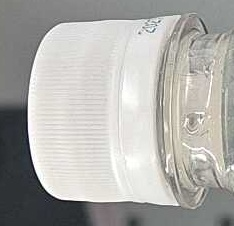
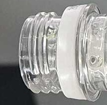

# Day 01 — 머신비전 검사문제 설계와 ROI

1일차에는 완성된 OK / NG 검사기를 만드는 것이 아니라,
이미지와 영상에서 **어디를 검사할 것인지 정하고,
정상과 불량의 차이를 어떻게 측정 가능한 특징으로 바꿀 것인지**
생각하는 과정을 학습했다.

## 핵심 흐름

```text
검사 문제 확인
    ↓
이미지 읽기
    ↓
ROI 설정
    ↓
여러 이미지에 같은 ROI 적용
    ↓
영상 Frame 처리
    ↓
영상 Frame에 ROI 적용
    ↓
스마트폰 실시간 영상 연결
    ↓
실시간 Frame에 ROI 적용
    ↓
새로운 검사 문제에 ROI 직접 적용
    ↓
결과와 판단 기록
```

## 결과

스마트폰 실시간 영상에서 같은 ROI로 잘라낸 정상 / 불량 이미지이다.

| 뚜껑 있음 (`cap_on`) | 뚜껑 없음 (`cap_off`) |
|---|---|
|  |  |

ROI 버전, 좌표, 결과 관찰 기록:
[day_01_problem_definitions.md](../reports/day_01_problem_definitions.md)
