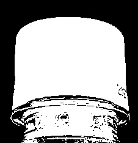
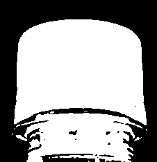

# Day 02 — Image Enhancement와 검사 영상 품질 개선

1일차에 설정한 ROI를 이용하여
촬영조건과 영상 품질이 검사 결과에 어떤 영향을 주는지 확인했다.

## 실습 내용

- BGR / Gray / HSV 비교
- Brightness / Contrast
- Gamma Correction
- CLAHE
- Gaussian / Median / Bilateral Filter
- Sharpening
- Threshold / Otsu
- 전처리 전·후 객체 분리 결과 비교
- Mini Challenge를 통한 전처리 직접 선택

## Mini Challenge — `cap_on.jpg` 전처리 직접 선택

| 시도 | 방법 | Otsu 결과 |
|---|---|---|
| 원본 | 전처리 없음 | 대체로 분리, 인쇄 글자 부분에 검은 점 |
| 1 | Contrast + CLAHE + Sharpening | 세로 홈이 강조되어 뚜껑 내부에 구멍 발생 |
| **2 (최종)** | **Contrast + Gaussian Blur** | **구멍 없는 흰 덩어리로 분리** |

| 원본 Otsu | 최종 전처리 후 Otsu |
|---|---|
|  |  |

이 이미지의 문제는 저대비가 아니라 뚜껑 표면의 무늬였다.
문제를 판단하지 않고 적용한 CLAHE와 Sharpening은 오히려 결과를 나쁘게 만들었다.
투명한 병목이 함께 잡히는 문제는 3일차에 확인한다.

- 자세한 분석: [day_02_preprocess_reason.md](../reports/day_02_preprocess_reason.md)
- Parameter 기록: [day02_parameter_table.csv](../reports/day02_parameter_table.csv)

## 오늘의 핵심

전처리 기술을 먼저 고르는 것이 아니라, 다음 순서로 판단한다.

```text
문제 확인
→ 필요한 전처리 선택
→ Parameter 비교
→ Threshold / Otsu 결과 확인
→ 사용 여부 결정
```

## 다음 학습

Day 03에서는 Binary 이미지에 Morphology와 Contour를 적용하여
객체의 면적·개수·위치를 측정하고, Rule 기반 OK / NG 판정으로 연결한다.
